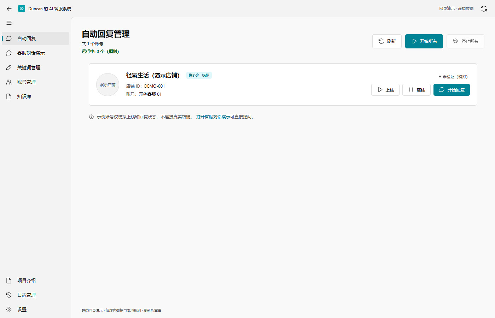
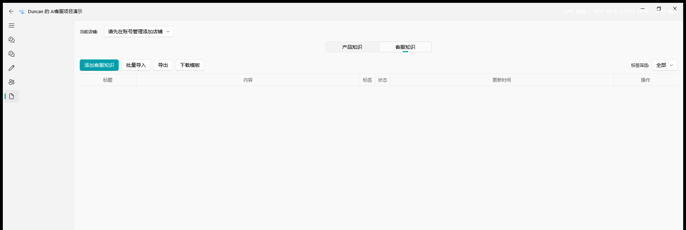
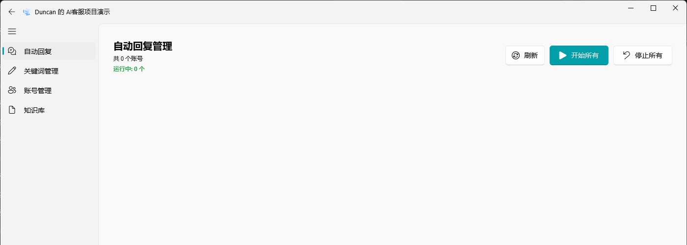
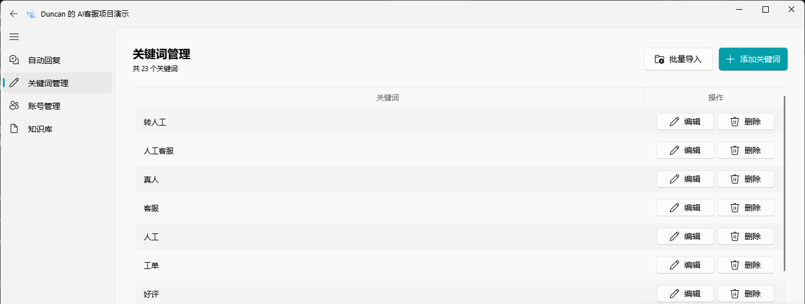
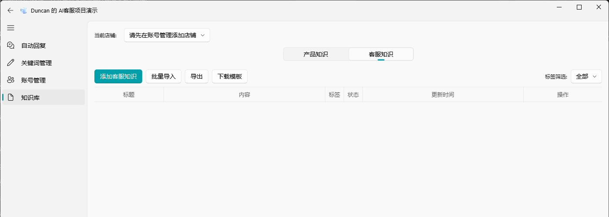
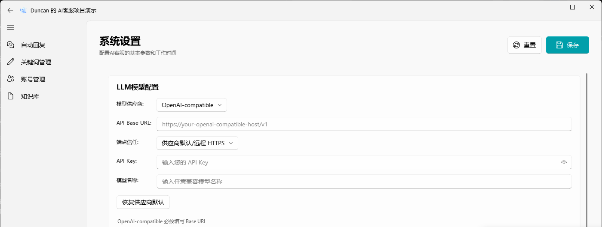

# 本地对话验证

网页体验：[AI 客服系统网页演示](https://duncan-maker117.github.io/customer-agent-demo/?v=desktop-20261022)。按桌面管理界面布局组织，可体验账号状态、关键词维护、知识编辑、设置保存及独立对话；全部为本地模拟，未调用模型或真实平台。

网页其他页面：[关键词管理](web-keywords.png) · [系统设置](web-settings.png) · [客服对话演示](web-chat.png) · [手机布局](web-mobile.png)

运行方式：在项目根目录执行 `uv sync --frozen`，再执行 `uv run --offline python app.py`。

## 功能检查流程

1. 打开“客服对话演示”。页面使用明确标记的虚构店铺和商品资料，不需要拼多多账号。
2. 点击“这件T恤是什么面料？”，检查问题、回复、知识来源和运行模式。无模型密钥时显示“离线知识匹配（未调用模型）”。
3. 点击“下单后几天能发货？”，展示售后知识检索和引用。
4. 点击“衣服穿过一次还能退吗？”，展示有条件的售后答复，不承诺知识库无法确认的结果。
5. 点击“我要投诉，转人工客服。”，展示人工升级建议；本地演示不会真的转接。
6. 点击“你们店里有蓝牙耳机吗？”，展示知识未命中时拒绝编造并建议人工核实。

配置模型密钥后，“使用已配置模型”会通过项目现有 LiteLLM 调用配置的模型；演示页关闭所有工具调用，并且不会发送平台消息。模型调用失败时会明确报错，不伪装成成功。

## 运行截图

## 其他界面

## 验证范围

已验证应用能启动，且离线演示处理器能对以上五种问题返回对应结果。本地还没有拼多多账号和模型密钥，所以真实平台接入与真实模型调用尚未验证。离线演示使用固定的虚构知识资料，是可运行的检索与回复逻辑，不应描述为 LLM 生成。
